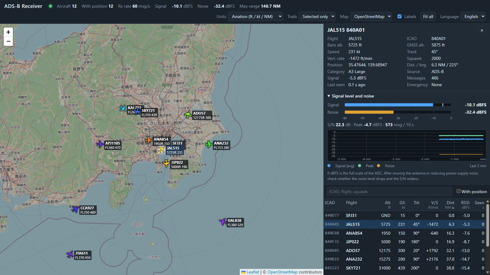

# adsbrx — an ADS-B receiver for RTL-SDR

[日本語](README.md) | **English**

adsbrx receives and decodes 1090 MHz ADS-B (Mode S extended squitter) with an RTL-SDR dongle.
It provides a **live aircraft table in the terminal**, a **web map**, and **SBS-1 / Beast / raw outputs** (it works with tar1090, Virtual Radar Server and similar tools).
It is written in Python. Without a dongle you can try everything with the built-in signal simulator and IQ file playback.



> The Japanese [README.md](README.md) is the complete documentation (benchmark tables, real-recording comparisons, CPU load, and more). This page is a shorter English version.

## Features

- **Pure Python (numpy) demodulator**: 2 MS/s 8-bit IQ → preamble detection → PPM demodulation → CRC-24 check, with 1-bit error correction and phase correction.
- **A sequence-detection demodulator for weak signals (default, `mlse`)**: Viterbi sequence detection with soft-decision CRC repair. On two real 5-minute daytime recordings it produced 58–73 % more valid frames than the classic demodulator (`classic`): the same aircraft, but more frames and more position updates per aircraft. In simulation, the same decoding rate needs a signal about 1–2 dB weaker. On a computer that is too slow, switch to the lighter `--demod classic`.
- **Decoding**: identification (callsign), airborne and surface position (CPR even/odd pairs and receiver-referenced local decoding), altitude, speed, track, vertical rate, squawk, and emergency state (7500 / 7600 / 7700).
- **Web map** (`http://127.0.0.1:8080/`): Leaflet is bundled. Aircraft icons (rotated by track, coloured by altitude), trails, range rings, an aircraft table (sorting, filtering, per-aircraft signal strength), a detail panel, **received signal level and noise level (with a 5-minute graph)**, a unit switch (aviation / metric), and a **Japanese / English language switch**.
- **Outputs**: dump1090-compatible JSON, SBS-1 (30003), Beast (30005), raw AVR (30002).
- **Inputs**: RTL-SDR (calls `rtlsdr.dll` / `librtlsdr` directly through ctypes), `rtl_tcp`, IQ files (cu8 / cs8 / cs16), standard input, and the simulator.
- **IQ recording**: `--record FILE` saves the raw IQ while receiving. Replay it later with `--file` to compare settings or demodulators on exactly the same signal.
- **No hardware needed for checks**: simulator, IQ generation / playback, a weak-signal benchmark, and about 485 automated tests.

## Requirements

| Item | Details |
|---|---|
| Software | Python 3.10 or newer (Windows / Linux / macOS). Verified on Windows with Python 3.13 and 3.14 |
| Real reception | An RTL-SDR dongle (RTL2832U; R820T / R820T2 / R828D / R860 tuners are common; real reception was verified with an RTL-SDR Blog V4 and a generic RTL2838 (R820T)) and a 1090 MHz antenna |
| On Windows | The WinUSB driver (Zadig) and `rtlsdr.dll` + `libusb-1.0.dll` (x64) |

## Installation

```powershell
git clone https://github.com/fractional-n/adsbrx.git
cd adsbrx
py -m venv .venv
.venv\Scripts\python.exe -m pip install -e ".[dev]"      # "dev" adds the test tools (use "." if you do not need them)
.venv\Scripts\adsbrx.exe --version                       # check
```

- If you do not have Git, use `Code` > `Download ZIP` on the GitHub page, unpack it, and run everything from `py -m venv .venv` onward in that folder.
- **You do not need to activate the virtual environment.** By default Windows PowerShell blocks scripts, so `.venv\Scripts\Activate.ps1` fails with `running scripts is disabled on this system`. Call `.venv\Scripts\python.exe` and `.venv\Scripts\adsbrx.exe` directly, as above (`.venv\Scripts\python.exe -m adsbrx` also works). To get a bare `adsbrx` command, run `Set-ExecutionPolicy -Scope Process -ExecutionPolicy Bypass` and then `.venv\Scripts\Activate.ps1`; this affects only that window and needs no administrator rights. In cmd.exe use `.venv\Scripts\activate.bat`.
- The examples below write just `adsbrx`. If you have not activated the environment, read it as `.venv\Scripts\adsbrx.exe`.
- Do not run `py -m venv .venv` again over an existing `.venv` that was created with a different Python; the installed packages no longer match and `import numpy` fails. Delete it first (`Remove-Item -Recurse -Force .venv`) and recreate it.
- On Linux / macOS, create it with `python3 -m venv .venv` and activate it with `source .venv/bin/activate`.

## Try it without hardware

```powershell
adsbrx --source sim --lat 35.55 --lon 139.78
```

This receives synthetic signals of 12 aircraft around Tokyo Haneda in real time. Open <http://127.0.0.1:8080/> to see them on the map. Add `-i` for an aircraft table in the terminal (Ctrl-C to quit).

You can also create and replay an IQ file:

```powershell
adsbrx simulate -o sample.cu8 --duration 20          # write synthetic IQ (4 MB per second)
adsbrx --file sample.cu8 --fast --stats               # decode as fast as possible and print statistics
adsbrx --file sample.cu8 --lat 35.55 --lon 139.78 --loop   # replay in real time, repeatedly (check it on the map)
adsbrx decode 8D4840D6202CC371C32CE0576098            # decode hex frames one by one, as JSON
```

## Receiving with a dongle

### 1. Windows setup

1. **WinUSB driver**: start [Zadig](https://zadig.akeo.ie/), choose `Options > List All Devices`, select `Bulk-In, Interface (Interface 0)` (or `RTL2838UHIDIR`), and replace its driver with `WinUSB`.
2. **DLLs**: get the 64-bit `rtlsdr.dll` (`librtlsdr.dll` also works) and `libusb-1.0.dll`. For example, take the newest `rtl-sdr-64bit-*.zip` from the [Osmocom rtl-sdr Windows builds](https://ftp.osmocom.org/binaries/windows/rtl-sdr/) (it also contains `libwinpthread-1.dll`, which goes in the same folder), or use the DLLs shipped with SDR#. Pass the folder with `--dll-dir`, or set the environment variable `ADSBRX_RTLSDR_DLL_DIR`.

```powershell
$env:ADSBRX_RTLSDR_DLL_DIR = 'C:\sdr\rtlsdr'      # example: the folder holding rtlsdr.dll and libusb-1.0.dll
adsbrx devices                                    # list the connected dongles
adsbrx --lat 35.55 --lon 139.78 -i                # start receiving (with the aircraft table)
```

On Linux: `sudo apt install librtlsdr0` (you also need the udev rules and a blacklist entry for the `dvb_usb_rtl28xxu` kernel driver). On macOS: `brew install librtlsdr`.

### 2. Tips for good reception

- Give `--lat` / `--lon` your **antenna position**. Distances and bearings are then shown, a position can be decoded from a single message (local CPR), and far-off wrong positions are rejected.
- The gain defaults to the maximum (`--gain max`). If a strong nearby source limits reception, try `--gain 40` (`--gain auto` is the tuner AGC).
- Put the antenna **outdoors, at a window, or anywhere with a clear view**. A 1090 MHz antenna (for example a quarter-wave ground plane, about 6.9 cm), short low-loss coax, and a 1090 MHz band-pass filter + LNA close to the antenna all help.
- Keep the antenna and dongle **away from the PC, the monitor (including video cables), chargers, and LED lights**. In one real case, just moving them away with a USB extension cable lowered the 1090 MHz noise level by about 6 dB and greatly reduced periodic pulse noise.
- Use `--ppm` for a dongle with a large crystal error.
- The default demodulator is `mlse`. It uses more CPU than `classic`; if you see `dropped blocks` warnings on a slow computer, use `--demod classic`.
- `--bias-tee` (RTL-SDR Blog V4 and others) feeds DC power to the antenna side. Use it **only for an LNA or an antenna with a built-in LNA**, never with an ordinary antenna that conducts DC. Without `--bias-tee`, adsbrx always switches the bias tee OFF at startup (a setting made in SDR# is not carried over), so if you power an LNA from the dongle's bias tee you need `--bias-tee`.

### 3. Other inputs

```powershell
adsbrx --rtl-tcp 192.168.1.20                      # receive from `rtl_tcp -a 0.0.0.0` on another machine (default port 1234)
adsbrx --record capture.cu8 --duration 240         # also save the raw IQ while receiving (stops after 4 minutes; Ctrl-C also works)
adsbrx --file capture.cu8 --fast --stats           # replay a recording
cmd /c "rtl_sdr -f 1090000000 -s 2000000 -g 40 - | adsbrx --source stdin"
```

Files and standard input are fixed at **2 MS/s**; the format is `--format cu8|cs8|cs16` (default cu8). On Windows, PowerShell pipes corrupt binary data, so always go through `cmd /c` when you use standard input.

`--record FILE` always saves **cu8** (4 MB per second, about 1 GB for 4 minutes), whatever the input is, and never overwrites an existing file (it exits with `already exists` before receiving starts). If the disk is too slow, receiving continues, part of the recording is dropped, and the count is shown. Avoid OneDrive and other synced or network folders.

## Outputs and integration

| Output | Default | Content |
|---|---|---|
| Web map | `http://127.0.0.1:8080/` | browser UI |
| JSON | `http://127.0.0.1:8080/data/aircraft.json` | dump1090-fa compatible (also `receiver.json`, `stats.json`, `trails.json`, `levels.json`) |
| SBS-1 | `127.0.0.1:30003` | BaseStation CSV (`MSG,1`–`8`, 22 fields) |
| Beast | `127.0.0.1:30005` | binary (timestamps in 12 MHz ticks) |
| raw (AVR) | `127.0.0.1:30002` | `*8D…;` hex text |

Change the ports with `--web-port` / `--sbs-port` / `--beast-port` / `--raw-port`; `0` disables that output.

| Tool | Setting |
|---|---|
| tar1090 / readsb | `--net-connector 127.0.0.1,30005,beast_in` (readsb connects to adsbrx) |
| Virtual Radar Server | Receiver: `BaseStation (SBS-1)` over the network, address `127.0.0.1`, port `30003` |
| Anything that reads `aircraft.json` | `http://127.0.0.1:8080/data/aircraft.json` |

> The outputs follow the published formats and are checked by automated tests, but connections to the other software have not been tried yet.

**Security**: by default only your own PC (127.0.0.1) can connect. `--bind 0.0.0.0` opens the outputs to your LAN, but there is no authentication or encryption, so use it only on a trusted LAN and never expose it directly to the Internet. The web UI and `receiver.json` contain the antenna position you gave with `--lat` / `--lon`.

## Using the web map

- Click an aircraft (or a row of the table) for the detail panel and its trail. Esc or a click on an empty part of the map deselects it.
- Sort with the column headings; the search box filters by ICAO, callsign, or squawk. "With position" hides aircraft whose position is unknown.
- The top menu switches units (aviation: ft / kt / NM, metric: m / km/h / km), trails (selected only / all / off), the map background, and labels. Settings are stored in the browser.
- The "言語 / Language" menu at the right end of the top menu switches the whole UI between **日本語 and English** (the default is Japanese). It is stored in the browser. Place names on the base map (OpenStreetMap) stay as the map data writes them.
- Aircraft with an emergency squawk (7500 / 7600 / 7700) are highlighted in red and a warning appears at the top.
- The base map uses OpenStreetMap tiles (Internet access needed); choose "No background" when offline. Please follow the [OSM tile usage policy](https://operations.osmfoundation.org/policies/tiles/).

### Signal level and noise

The "Signal level and noise" panel (and the numbers at the top) shows the received **signal level**, the **peak**, the **noise level**, and the **S/N**, in **dBFS** (0 dBFS = ADC full scale; larger is stronger), the same scale as the per-aircraft signal column.

- **Signal**: average power of the frames decoded in the last 10 seconds (`-` when there were none). **Peak**: the strongest frame in the last 10 seconds. **Noise**: noise power derived from the median amplitude of all samples, including the parts without frames; frames are only a few percent of the samples, so it hardly moves with traffic. **S/N**: signal minus noise.
- The graph shows the last 5 minutes, one point per second.
- **How to use it**: after you change the antenna position or direction, the extension cable, the LNA or filter, or the power supply, check whether the noise drops and the S/N widens. A gain change moves signal and noise by the same amount, so keep the gain the same when you compare.
- **Caveats**: S/N reads up to about 3 dB lower than the S/N of the pulses alone (about half of each frame is silent). If the noise does not go below about −36 dBFS, that is the floor of the 8-bit quantisation. The values are relative, not calibrated dBm.
- **JSON**: `/data/levels.json` returns `now`, `window` (seconds), `noise`, `signal`, `peak`, `snr`, `messages`, and a per-second `history` (`[t, noise, signal, peak, frames]`, up to 300 s). `?since=<t>` returns only newer `history` rows.

## Command-line options

`adsbrx --help` is the exact list. The main options:

- **Input**: `--source {rtlsdr,rtl_tcp,file,stdin,sim}`, `--device-index N`, `--gain DB|max|auto`, `--ppm PPM`, `--agc`, `--bias-tee`, `--dll-dir DIR`, `--rtl-tcp HOST[:PORT]`, `--file PATH`, `--format {cu8,cs8,cs16}`, `--loop`, `--fast`, `--speed X`, `--seed N`, `--record FILE`
- **Receiver and decoder**: `--lat` / `--lon` (antenna position), `--demod {mlse,classic}`, `--no-fix` (no error repair), `--aggressive` (also repair 2-bit errors: more messages, more risk of wrong data), `--mode-s` (also accept DF0/4/5/16/20/21 replies from aircraft already heard), `--expire S` (forget an aircraft after S seconds, default 60), `--max-range NM` (reject farther positions, default 300, 0 = no limit)
- **Output**: `--bind ADDR`, `--web-port`, `--sbs-port`, `--beast-port`, `--raw-port`, `-i` (aircraft table), `--raw` (print `*HEX;` to stdout), `--stats`
- **Running**: `--hold`, `--duration S`, `-v`, `-q`

Sub-commands: `simulate` (write a synthetic IQ file), `devices` (list dongles), `decode` (decode hex frames).
Exit codes: 0 = success, 1 = error, 2 = invalid arguments. Logs go to standard error; the summary and the aircraft table go to standard output.

## Demodulators: `mlse` and `classic`

The default `mlse` uses **sequence detection and soft-decision repair**, so it decodes many more weak signals, including ones whose sample points fall on a chip boundary. `classic` is the lighter, dump1090-style demodulator; it decodes strong signals reliably. Use `--demod classic` if you see `dropped blocks` warnings (for example on a Raspberry Pi).

- **Simulation**: the same decoding rate needs a signal about 1–2 dB weaker with `mlse`; at a peak SNR of 18 dB `classic` levels off at about 76 % while `mlse` decodes almost everything. No wrong frame was produced, including 10 seconds of noise only. The simulator is not calibrated against real hardware.
- **Real recordings**: two 5-minute daytime recordings (2026-10-12, a generic RTL2838 / R820T dongle, a simple antenna without filter or LNA) were processed by both demodulators. `mlse` gave **+73 % and +58 % valid frames** (1,203 → 2,081 and 1,645 → 2,600), and +50–80 % positions. The aircraft were the same (6–7), with no new unknown ICAO addresses and no rejected positions: the gain is more frames (position updates) per aircraft, and it grows with distance. This is one place, one antenna, and two recordings, so please check on your own setup with `--record` and `--file`.
- **CPU**: `mlse` is about 3–5 times heavier than `classic` (about 15–20 MS/s against 60–80 MS/s on a Core i5-14400; real time needs 2 MS/s), which is still plenty for real time.

Compare the two on your own recording like this:

```powershell
adsbrx --file capture.cu8 --fast --stats --demod classic --web-port 0 --sbs-port 0 --beast-port 0 --raw-port 0
adsbrx --file capture.cu8 --fast --stats --demod mlse    --web-port 0 --sbs-port 0 --beast-port 0 --raw-port 0
```

The weak-signal benchmark: `python -m adsbrx.sim.bench` (about 10 seconds).

## Troubleshooting

| Symptom | What to do |
|---|---|
| `.venv\Scripts\Activate.ps1` fails with `running scripts is disabled on this system` | You do not need to activate it; call `.venv\Scripts\python.exe` and `.venv\Scripts\adsbrx.exe` directly (see Installation) |
| `librtlsdr was not found` | Pass the folder with `rtlsdr.dll` / `libusb-1.0.dll` (x64) via `--dll-dir` or `ADSBRX_RTLSDR_DLL_DIR`. Python must be 64-bit too |
| `No RTL-SDR device found` | Check the USB connection. On Windows install WinUSB with Zadig. Make sure SDR# or another program is not using the dongle |
| `cannot listen for … on …:PORT` | Another program (dump1090, readsb, …) uses the port. Change it (`--web-port 8081`) or disable it with `0` |
| No aircraft | Check the antenna (connection, loose SMA connector), gain, and location. With `--stats`, a `valid_crc` count that is very small compared with `preambles` means a weak or noisy signal |
| Few aircraft, or only near ones | Often 1090 MHz noise: keep the antenna away from the PC, monitor, video cables, chargers, and LED lights; use a USB extension cable (with a ferrite); then consider a 1090 MHz band-pass filter + LNA. Compare `--stats` before and after each change |
| `Enabled direct sampling mode` / `[R82XX] PLL not locked!` right after start | Harmless messages that librtlsdr (the RTL-SDR Blog version) prints once at the first frequency setting. Ignore them |
| `dropped blocks` warnings | The PC or USB cannot keep up. Stop heavy programs, try another USB port, or use `--demod classic` |
| `--record` fails with `cannot record to …: it already exists` | An existing file is never overwritten; use another name or delete it |
| `the disk was too slow: N blocks are missing from the recording` | The recording has gaps (receiving was not interrupted). Save to a fast drive, not OneDrive or a network drive |
| `-i` display is garbled | Use a terminal that supports ANSI (for example Windows Terminal); otherwise a one-line summary is printed every 10 seconds |

## How it works

```
input  RTL-SDR / rtl_tcp / IQ file / stdin / simulator        <- reader thread
  |    2 MS/s IQ blocks
  v
demodulator  preamble detection -> PPM -> CRC-24 / repair     <- demodulator thread
  |    Mode S messages
  v
tracker  per-ICAO state, CPR positions, trails                <- asyncio event loop
  |-- console table (-i)
  |-- web map / JSON  (:8080, aiohttp)
  |-- SBS-1 (:30003)
  |-- Beast (:30005)
  '-- raw   (:30002)
```

```
src/adsbrx/
  cli.py app.py               command line / wiring
  sources.py rtl_native.py    inputs (including the ctypes wrapper of librtlsdr)
  recorder.py                 IQ recording (--record)
  pipeline.py demod.py mlse.py crc.py cpr.py modes.py tracker.py geo.py levels.py   receive processing
  outputs/                    sbs / beast / netserver / web / console
  static/                     web UI (index.html, app.js, i18n.js, style.css, vendor/leaflet)
  sim/                        synthetic signals (encoder, modulator, scenario) and the benchmark (bench.py)
tests/                        pytest (including cross-checks against pyModeS)
```

## Development and tests

```powershell
pytest                                   # all tests (about 40 seconds)
$env:ADSBRX_TEST_RTLSDR_DLL_DIR = 'C:\path\to\dll'; pytest tests\test_rtl_native.py   # also test loading a real DLL
```

Decoded values are cross-checked with [pyModeS](https://github.com/junzis/pyModeS) (part of the `dev` dependencies; it needs Python 3.11 or newer, so on 3.10 only those cross-check tests are skipped).
GitHub Actions (`.github/workflows/ci.yml`) runs the tests on Linux, Windows, and macOS with Python 3.10–3.14 for every push and pull request.
The UI strings (Japanese / English) are in the dictionary in `src\adsbrx\static\i18n.js`; when you add one, add the same key for both languages (`tests\test_web_i18n.py` checks the dictionary, `index.html`, and `app.js`).

## Current limitations

- **Real-hardware verification was done on Windows only** (an RTL-SDR Blog V4 and an RTL2838 / R820T, streaming at 2 MS/s through `rtlsdr.dll` with no lost samples). Linux and macOS are supported in code and tested in CI, but have not been tried with a dongle.
- Real airliners were received and decoded. Positions, altitudes, and speeds match pyModeS and are consistent with OpenSky public data, and the SBS / Beast / raw outputs carry the same frames. A 4-minute IQ recording decoded about as many frames as another ADS-B decoder (matched filter + soft decision) did (DF17: 29 vs 31, DF11: 46 vs 46 with `--aggressive`). A serious sensitivity evaluation and connection tests with tar1090 / Virtual Radar Server / readsb have not been done.
- The `mlse` real-hardware check covers only two recordings at one location with one antenna.
- DF11 replies that carry an interrogator identifier (II/SI) cannot be repaired when they have bit errors (about half of the DF11 frames in the real recordings had one). DF11 carries no position, so positions are not affected.
- The sample rate is fixed at 2 MS/s (inputs of 2.4 MS/s or more are not supported).
- MLAT, merging several receivers, BDS register decoding of Comm-B (DF20/21), and the detailed handling of TIS-B / ADS-R are out of scope.
- The web and network outputs have no authentication or encryption (see Security above).

## License

[MIT License](LICENSE) (Copyright (c) 2026 fractional-n).

### Bundled and third-party software

| Name | License | How adsbrx uses it |
|---|---|---|
| [Leaflet](https://leafletjs.com/) 1.9.4 | BSD-2-Clause | Bundled with the web UI (`src/adsbrx/static/vendor/`; the full text is in `LEAFLET-LICENSE.txt`) |
| [numpy](https://numpy.org/) | BSD-3-Clause and others | A dependency (pip fetches it at install time; not bundled) |
| [aiohttp](https://docs.aiohttp.org/) | Apache-2.0 (partly MIT) | A dependency (same) |
| [pyModeS](https://github.com/junzis/pyModeS) | GPL-3.0 | Used only by the tests (a `dev` dependency); not bundled or distributed |
| librtlsdr / libusb | GPL-2.0 or later / LGPL-2.1 or later | **Not bundled.** For real reception you provide the DLLs / shared libraries, which are loaded at run time |
| [OpenStreetMap](https://www.openstreetmap.org/copyright) | ODbL (map data), CC BY-SA 2.0 (tile cartography) | The browser fetches the background tiles from OSM servers (see "Using the web map"). The map in the screenshots under `docs/images/` is also OSM's and is not covered by the MIT License |

## Disclaimer

- This is receive-only software (it cannot transmit). It is for hobby, learning, and research use. **Do not use it for flight operations, navigation, air traffic control, or anything safety-related**: it can miss aircraft, show wrong data, or be late.
- Laws and rules about receiving radio signals and about using or publishing aircraft information differ by country and region. Please check them and follow them yourself.
- The antenna position (`--lat` / `--lon`) is included in the web UI and in `receiver.json`. If you expose them to the Internet, the location of your receiver (for example your home) may become known.
- As the MIT License says, the software is provided without warranty.

## Acknowledgments and references

- [dump1090](https://github.com/antirez/dump1090) (Salvatore Sanfilippo) and its descendants ([dump1090-fa](https://github.com/flightaware/dump1090), [readsb](https://github.com/wiedehopf/readsb), and others): a reference for the method of the `classic` demodulator and for the JSON, SBS-1, Beast, and raw output formats. The implementation is an independent one in numpy.
- [The 1090 Megahertz Riddle](https://mode-s.org/1090mhz/) (Junzi Sun): an explanation of how Mode S / ADS-B works. [pyModeS](https://github.com/junzis/pyModeS) (by the same author): used to cross-check decoded values.
- [rtl-sdr (Osmocom)](https://osmocom.org/projects/rtl-sdr): the library for RTL-SDR dongles (including `rtl_tcp`).
- The contributors of [Leaflet](https://leafletjs.com/) and [OpenStreetMap](https://www.openstreetmap.org/): the web map.
- [OpenSky Network](https://opensky-network.org/): public data was used to check the results of real reception.
