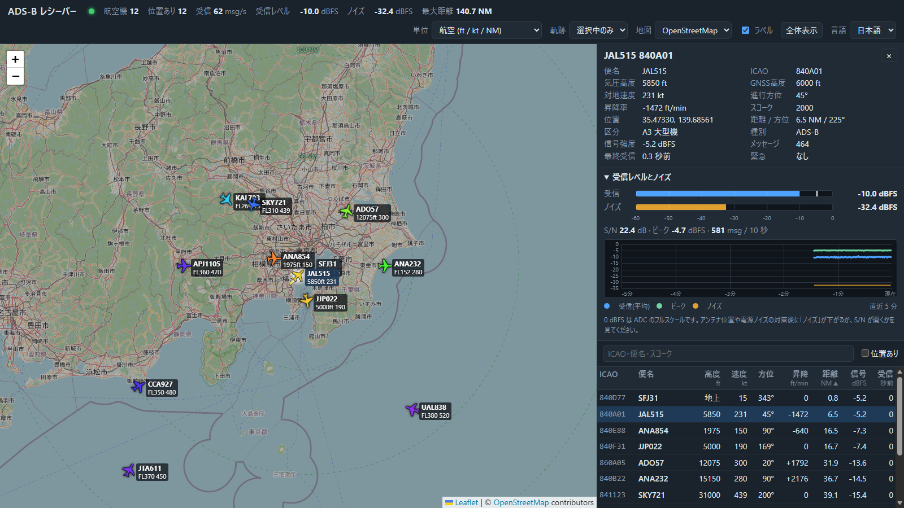

# adsbrx — RTL-SDR ADS-B 受信ソフト

**日本語** | [English](README.en.md)

RTL-SDR ドングルで 1090 MHz の ADS-B（Mode S 拡張スキッタ）を受信・デコードし、
**ターミナルの機体一覧**、**Web 地図**、**SBS-1 / Beast / raw 出力**（tar1090・Virtual Radar Server などと連携可能）として提供する
Python 製のソフトウェアです。ドングルが無くても、内蔵の信号シミュレータと IQ ファイルの再生で動作を確認できます。



## 特長

- **純 Python（numpy）のデモジュレータ**: 2 MS/s の 8 bit IQ からプリアンブル検出 → PPM 復調 → CRC-24 検証。1 ビット誤り訂正と位相補正つき
- **弱い信号に強い系列検出デモジュレータ（既定、`mlse`）**: Viterbi 系列検出 + 軟判定 CRC 訂正。実機の録画（昼間 5 分を 2 回）では、従来方式（`classic`）より有効フレームが 58〜73 % 多く（受信できた機体は同じで、機体ごとのフレーム数と位置の更新が増えます）、シミュレーションでも同じ復号率に必要な信号が約 1〜2 dB 小さくて済みます。CPU が足りないコンピュータでは、軽量な `--demod classic` に切り替えられます（「弱い信号をもっと拾う」参照）
- **デコード**: 識別（便名）・空中/地上位置（CPR の偶奇ペアと受信局基準のローカルデコード）・高度・速度・方位・昇降率・スコーク・緊急信号（7500/7600/7700）
- **Web 地図** (`http://127.0.0.1:8080/`): Leaflet 同梱。機体アイコン（進行方向で回転・高度で色分け）、軌跡、距離リング、機体一覧（並べ替え・絞り込み・機体ごとの信号強度）、詳細パネル、**受信レベルとノイズレベルの表示（直近 5 分の推移グラフつき）**、単位切替（航空 / メートル法）、**表示言語の切替（日本語 / English）**
- **出力**: dump1090 互換 JSON、SBS-1（30003）、Beast（30005）、raw AVR（30002）
- **入力**: RTL-SDR 直結（ctypes で `rtlsdr.dll` / `librtlsdr` を直接呼び出し）、`rtl_tcp`、IQ ファイル（cu8/cs8/cs16）、標準入力、シミュレータ
- **IQ の録画**: `--record FILE` で、受信しながら生の IQ をファイルに保存。あとで `--file` で再生すれば、同じ信号で設定や復調方式を比べられます
- **ハードウェア不要の検証手段**: シミュレータ・IQ 生成/再生・弱信号ベンチマーク・自動テスト（約 485 件）

## 必要なもの

| 項目 | 内容 |
|---|---|
| ソフト | Python 3.10 以上（Windows / Linux / macOS。Windows の Python 3.13 / 3.14 で動作確認済み） |
| 実機受信 | RTL-SDR ドングル（RTL2832U。R820T / R820T2 / R828D / R860 搭載品が一般的。RTL-SDR Blog V4 と汎用の RTL2838（R820T）で実受信を確認済み）と 1090 MHz 用アンテナ |
| Windows の場合 | WinUSB ドライバ（Zadig）と `rtlsdr.dll` + `libusb-1.0.dll`（x64） |

## インストール

```powershell
git clone https://github.com/fractional-n/adsbrx.git
cd adsbrx
py -m venv .venv
.venv\Scripts\python.exe -m pip install -e ".[dev]"      # dev はテスト用（不要なら ".")
.venv\Scripts\adsbrx.exe --version                       # 動作確認
```

- Git が無いときは、GitHub のリポジトリのページで `Code` > `Download ZIP` からダウンロードして展開し、そのフォルダで `py -m venv .venv` 以降を実行します。
- **仮想環境の有効化（`Activate.ps1`）は不要です。** Windows の PowerShell は既定でスクリプトの実行を禁止しているため、`.venv\Scripts\Activate.ps1` は「スクリプトの実行が無効になっているため…読み込めません」（英語表示では `running scripts is disabled on this system`）というエラーになります。上のように `.venv\Scripts\python.exe` / `.venv\Scripts\adsbrx.exe` を直接呼び出せば、有効化しなくてもインストールと起動ができます（`.venv\Scripts\python.exe -m adsbrx` でも同じです）。
- 以降の例は `adsbrx` とだけ書いています。有効化していない場合は `.venv\Scripts\adsbrx.exe` に読み替えてください。`adsbrx` とだけ入力したい場合は、PowerShell で `Set-ExecutionPolicy -Scope Process -ExecutionPolicy Bypass` を実行してから `.venv\Scripts\Activate.ps1` を実行します（そのウィンドウだけ有効で、管理者権限は不要です）。cmd.exe なら `.venv\Scripts\activate.bat` です。
- `.venv` が既にあるときは `py -m venv .venv` を重ねて実行しないでください。作成時と違う Python で上書きすると、入っているパッケージと食い違って `import numpy` などが失敗します。`Remove-Item -Recurse -Force .venv` で削除してから作り直します。
- Linux / macOS は `python3 -m venv .venv` で作り、`source .venv/bin/activate` で有効化します。

## まず試す（ハードウェア不要）

```powershell
adsbrx --source sim --lat 35.55 --lon 139.78
```

羽田周辺を飛ぶ 12 機の合成信号をリアルタイムで受信します。ブラウザで <http://127.0.0.1:8080/> を開くと地図に機体が現れます。
ターミナルに機体一覧を出したい場合は `-i` を付けます（Ctrl-C で終了）。

IQ ファイルを作って再生することもできます。

```powershell
adsbrx simulate -o sample.cu8 --duration 20          # 合成 IQ を作成（1 秒 = 4 MB）
adsbrx --file sample.cu8 --fast --stats               # できるだけ速くデコードして統計を表示
adsbrx --file sample.cu8 --lat 35.55 --lon 139.78 --loop   # 実時間で繰り返し再生（地図で確認）
adsbrx decode 8D4840D6202CC371C32CE0576098            # 16 進のフレームを 1 件ずつ JSON で表示
```

## 実機で受信する

### 1. Windows の準備

1. **WinUSB ドライバ**: [Zadig](https://zadig.akeo.ie/) を起動 → `Options > List All Devices` → `Bulk-In, Interface (Interface 0)`（または `RTL2838UHIDIR`）を選び、`WinUSB` に置き換えます。
2. **DLL**: 64 bit の `rtlsdr.dll`（`librtlsdr.dll` でも可）と `libusb-1.0.dll` を用意します。
   入手先の例は、[Osmocom の rtl-sdr Windows ビルド](https://ftp.osmocom.org/binaries/windows/rtl-sdr/)（最新の `rtl-sdr-64bit-*.zip`。`libwinpthread-1.dll` も同梱されているので同じフォルダに置きます）や SDR# の同梱品です。
   フォルダを `--dll-dir` で渡すか、環境変数 `ADSBRX_RTLSDR_DLL_DIR` に設定します。

```powershell
$env:ADSBRX_RTLSDR_DLL_DIR = 'C:\sdr\rtlsdr'      # 例: rtlsdr.dll と libusb-1.0.dll を置いたフォルダ
adsbrx devices                                    # 接続中のドングルを表示
adsbrx --lat 35.55 --lon 139.78 -i                # 受信開始（機体一覧つき）
```

Linux は `sudo apt install librtlsdr0`（udev ルールと、`dvb_usb_rtl28xxu` カーネルドライバの blacklist も必要）、macOS は `brew install librtlsdr` です。

### 2. 受信のコツ

- `--lat` / `--lon` に**アンテナの緯度経度**を渡すと、距離・方位が出て、1 メッセージだけでも位置を求められ（ローカル CPR）、遠方の誤った位置も弾けます。
- ゲインは既定が最大（`--gain max`）です。近くに強い電波源があって受信数が少ない場合は `--gain 40` などを試します（`--gain auto` はチューナー AGC）。
- アンテナは **屋外・窓際・見通しの良い場所** に。1090 MHz 用のアンテナ（1/4 波長 約 6.9 cm のグラウンドプレーン等）、短く低損失の同軸、アンテナ直近の 1090 MHz BPF + LNA が効果的です。
- アンテナとドングルは **PC・モニター（映像ケーブル含む）から離します**。USB 延長ケーブルで離すだけで、1090 MHz の雑音レベルが約 6 dB 下がり、周期的なパルスノイズが大きく減った実例があります（「現状の制限・今後の課題」参照）。
- 水晶の誤差が大きいドングルは `--ppm` で補正します。
- 復調は既定で、弱い信号に強い系列検出（`--demod mlse`）です。軽量な `--demod classic` より CPU を使うので、非力なコンピュータで `dropped blocks` の警告が出るときは `--demod classic` にしてください（「弱い信号をもっと拾う」参照）。
- `--bias-tee`（RTL-SDR Blog V4 など）はアンテナ側へ DC 給電します。**LNA 内蔵アンテナ・LNA 用**にだけ使い、通常のアンテナ（DC 的に導通しているもの）には使わないでください。指定しない場合は起動時にバイアスティーを必ず OFF にします（SDR# などで ON にしていても引き継がれないので、LNA をドングルのバイアスティーで給電しているなら `--bias-tee` が必要です）。

### 3. その他の入力

```powershell
adsbrx --rtl-tcp 192.168.1.20                      # 別マシンの `rtl_tcp -a 0.0.0.0` から受信（既定ポート 1234）
adsbrx --record capture.cu8 --duration 240         # 受信しながら生の IQ も保存（4 分で終了。Ctrl-C でも止められる）
adsbrx --file capture.cu8 --fast --stats           # 録画を再生
rtl_sdr -f 1090000000 -s 2000000 -g 40 capture.cu8 # （adsbrx を使わず）rtl_sdr で IQ を録画する場合
cmd /c "rtl_sdr -f 1090000000 -s 2000000 -g 40 - | adsbrx --source stdin"
```

標準入力・ファイルは **サンプルレート 2 MS/s 固定**、形式は `--format cu8|cs8|cs16`（既定 cu8）です。
Windows では PowerShell のパイプがバイナリを壊すため、標準入力を使うときは必ず `cmd /c` 経由にしてください。

`--record FILE` は、どの入力でも、受け取った IQ を**常に cu8 形式**で保存します（1 秒 4 MB、4 分で約 1 GB）。すでにあるファイルは**上書きしません**（受信を始める前に `already exists` で終了）。
ディスクが遅くて書き込みが追いつかないときは、受信は止めずに録画の一部を捨て、ステータス行と終了時に件数を表示します。ディスクがいっぱいになるなど書き込みに失敗したときは、そこまでの録画を残して終了コード 1 で終了します。
OneDrive などの同期フォルダやネットワークドライブは避けてください。

## 出力と他ソフトとの連携

| 出力 | 既定の場所 | 内容 |
|---|---|---|
| Web 地図 | `http://127.0.0.1:8080/` | ブラウザ用 UI |
| JSON | `http://127.0.0.1:8080/data/aircraft.json` | dump1090-fa 互換（`receiver.json` / `stats.json` / `trails.json` / `levels.json` もあり） |
| SBS-1 | `127.0.0.1:30003` | BaseStation 形式の CSV（`MSG,1〜8`、22 項目） |
| Beast | `127.0.0.1:30005` | バイナリ形式（タイムスタンプは 12 MHz 換算） |
| raw (AVR) | `127.0.0.1:30002` | `*8D…;` の 16 進テキスト |

各ポートは `--web-port` / `--sbs-port` / `--beast-port` / `--raw-port` で変更でき、`0` を指定するとその出力を無効にします。

| 連携先 | 設定 |
|---|---|
| tar1090 / readsb | `--net-connector 127.0.0.1,30005,beast_in`（readsb が adsbrx に接続） |
| Virtual Radar Server | Receiver を `BaseStation (SBS-1)` / Network、アドレス `127.0.0.1`、ポート `30003` |
| Beast・AVR・SBS を入力にできる他のツール | 上のポートに接続 |
| `aircraft.json` を読むツール | `http://127.0.0.1:8080/data/aircraft.json` |

> 出力は公開されている形式に沿って実装し、自動テストで検証していますが、各ソフトとの実接続は未確認です。

**セキュリティ**: 既定では自分の PC（127.0.0.1）からしか接続できません。`--bind 0.0.0.0` で LAN に公開できますが、
認証も暗号化もないため、信頼できる LAN の中だけで使ってください（インターネットへ直接公開しないこと）。

## Web 地図の使い方

- 機体をクリック（または一覧の行をクリック）すると詳細パネルと軌跡が出ます。Esc か地図の空白クリックで解除。
- 一覧の見出しで並べ替え、検索欄で ICAO・便名・スコークを絞り込めます。「位置あり」で位置不明の機体を隠せます。
- 上部のメニューで単位（航空: ft / kt / NM、メートル法: m / km/h / km）、軌跡（選択中のみ / すべて / なし）、地図背景、ラベル表示を切り替えます。設定はブラウザに保存されます。
- 上部メニュー右端の「言語 / Language」で、表示言語を **日本語 / English** から選べます（既定は日本語）。メニュー・一覧・詳細パネル・グラフ・警告の文言がその場で切り替わり、選んだ言語はブラウザに保存されます。背景地図（OpenStreetMap）の地名は地図データ側の表記のままです。
- 緊急スコーク（7500 / 7600 / 7700）の機体は赤で強調され、画面上部に警告が出ます。
- 背景地図は OpenStreetMap のタイル（インターネット接続が必要）。オフラインでは「背景なし」を選びます。タイルの利用は [OSM のタイル利用規約](https://operations.osmfoundation.org/policies/tiles/) に従ってください。

### 受信レベルとノイズ

画面右の「受信レベルとノイズ」パネルと、上部の数値に表示します。単位は **dBFS**（0 dBFS = ADC のフルスケール。値が大きいほど強い）で、一覧の「信号」列（機体ごとの直近フレームの信号強度）と同じ基準です。

| 項目 | 意味 |
|---|---|
| 受信レベル | 直近 10 秒に復号できたフレームの平均信号強度（電力の平均）。フレームが無いときは `-` |
| ピーク | 直近 10 秒で最も強かったフレーム（バーの白い線） |
| ノイズ | フレームの無い部分を含む全サンプルの振幅の中央値から求めた雑音電力。フレームは全体の数 % なので、交通量が増えても値はあまり動きません |
| S/N | 受信レベル − ノイズ |

- グラフは直近 5 分の 1 秒ごとの推移です（青: 受信レベル、緑: ピーク、橙: ノイズ）。
- 受信が止まると表示が薄くなります。パネルの見出しをクリックすると畳めます（設定はブラウザに保存されます）。
- **使い方**: アンテナの位置・向き、延長ケーブル、LNA・フィルタ、電源などを変えたときに、「ノイズ」が下がるか、S/N が開くかを見ます。ゲインを変えると受信レベルもノイズも同じだけ動くので、比べるときはゲインを揃えてください。
- **読み方の注意**: S/N は、パルスだけで測った値より最大 3 dB ほど小さく出ます（フレームの約半分は無信号のため）。ノイズが −36 dBFS 付近から下がらないときは 8 bit の量子化の下限で、これより小さい雑音は測れません（アンテナを外しても同じ値になります）。較正された dBm ではなく、同じドングル・同じゲインで比べるための相対値です。
- **JSON**: `/data/levels.json` は `now`・`window`（秒）・`noise`・`signal`・`peak`・`snr`・`messages` と、1 秒ごとの `history`（`[t, noise, signal, peak, frames]`、最大 300 秒）を返します。値が無いところは `null` です。`?since=<t>` を付けると、それより新しい `history` の行だけになります。`stats.json` の `levels` には、`history` を除いた同じ値が入ります。

## コマンドラインオプション

`adsbrx --help` が正確な一覧です。主なものは次のとおりです。

| 分類 | オプション | 説明 |
|---|---|---|
| 入力 | `--source {rtlsdr,rtl_tcp,file,stdin,sim}` | 入力元（`--file` / `--rtl-tcp` を付けると自動で決まる） |
| | `--device-index N` / `--gain DB\|max\|auto` / `--ppm PPM` / `--agc` / `--bias-tee` | ドングルの設定 |
| | `--dll-dir DIR` | `rtlsdr.dll` のあるフォルダ（環境変数 `ADSBRX_RTLSDR_DLL_DIR` でも可） |
| | `--file PATH` `--format` `--loop` `--fast` `--speed X` | IQ ファイル再生（`--fast` は実時間にこだわらない） |
| | `--seed N` | シミュレータの乱数シード |
| | `--record FILE` | 受信しながら生の IQ（cu8、1 秒 4 MB）を新しいファイルに保存（`--file` で再生できる。既存のファイルは上書きしない） |
| 受信 | `--lat` / `--lon` | アンテナの位置 |
| | `--demod {mlse,classic}` | 復調方式。`mlse`（既定。系列検出 + 軟判定訂正。弱い信号を多く復号、CPU は `classic` の約 3〜5 倍）/ `classic`（軽量。非力なコンピュータ向け）。「弱い信号をもっと拾う」参照 |
| | `--no-fix` / `--aggressive` | 誤り訂正を無効 / 2 ビットまで訂正（誤データのリスク増）。`mlse` では軟判定訂正にも同じく効く |
| | `--mode-s` | 高度・識別・ACAS の Mode S 応答（DF0/4/5/16/20/21）も、すでに受信できた機体について受け付ける（既定は ADS-B のみ） |
| | `--expire S` / `--max-range NM` | 機体を忘れるまでの秒数（60）/ 位置の最大距離（300、0 で無制限） |
| 出力 | `--bind ADDR` / `--web-port` / `--sbs-port` / `--beast-port` / `--raw-port` | 待ち受けアドレス・ポート |
| | `-i` / `--raw` / `--stats` | 機体一覧表示 / `*HEX;` を標準出力へ / 終了時に統計 |
| 実行 | `--hold` / `--duration S` / `-v` / `-q` | 入力終了後も出力を維持 / S 秒で停止 / ログ詳細 / 静か |

サブコマンド: `simulate`（合成 IQ の作成）、`devices`（ドングル一覧）、`decode`（16 進フレームのデコード）。
終了コードは正常 0、エラー 1、引数エラー 2 です。ログは標準エラー、サマリーと機体一覧は標準出力に出ます。

## 弱い信号をもっと拾う（復調方式 `mlse` / `classic`）

既定の復調器は `mlse` で、**系列検出 + 軟判定訂正**により、弱い信号や、サンプル点がチップの境目にずれた信号も多く復号します。
従来の軽量な復調器（`classic`。dump1090 と同じ考え方で、強い信号は確実に復号できます）に切り替えるには `--demod classic` を指定します。CPU が足りずに `dropped blocks` の警告が出るとき（Raspberry Pi など）は、こちらにしてください。

```powershell
adsbrx --lat 35.55 --lon 139.78 -i                    # 既定（mlse）
adsbrx --demod classic --lat 35.55 --lon 139.78 -i    # 軽量な従来方式
```

- **系列検出（Viterbi / MLSE）**: ビットごとに前半・後半のチップの大小を比べる代わりに、帯域制限によるにじみ（隣のチップからの干渉）を含めたモデルで、メッセージ全体の波形に最もよく合うビット列を求めます。プリアンブルの形からサンプル点とチップのずれ（タイミング位相）も推定し、候補ごとに有力な順に最大 3 通りの仮説を試します。
- **軟判定 CRC 訂正**: CRC が合わないメッセージは、ビットごとの信頼度が低い方から 12 ビットの中で最大 3 ビットを反転し、CRC が通る組み合わせを探します（`--aggressive` では 14 ビット中 4 ビットまで）。誤訂正を避けるため、すでに受信できた機体（ICAO が既知）のメッセージにしか適用しません。
- 短いメッセージ（DF11、56 ビット）は 56 ビットで打ち切って判定します。
- `--no-fix` は 1 ビット訂正と軟判定訂正の両方を止めます。`--aggressive` は 2 ビットまでの訂正と、上の広い軟判定を使います。
- `--stats` には、軟判定で救えた数（`soft-decision-corrected`）と、2 番目以降のタイミング仮説で見つかった数（`found by a runner-up timing`）が出ます。

### シミュレーションでの効果

内蔵シミュレータの DF17 を、信号のピーク振幅を変えて復号したときの復号率［%］です（雑音は I/Q 各軸 rms 8.5 カウント、フロントエンド帯域 1 MHz、12 通りのタイミング位相 × 40 フレーム × 8 通りの振幅 = 3,840 フレーム）。

| 信号のピーク振幅［カウント］ | 24 | 30 | 36 | 40 | 48 | 60 | 80 | 100 |
|---|---|---|---|---|---|---|---|---|
| ピーク SNR［dB］ | 6.0 | 7.9 | 9.5 | 10.4 | 12.0 | 14.0 | 16.5 | 18.4 |
| `classic` | 0 | 0 | 3.8 | 12.5 | 38.8 | 57.5 | 69.8 | 75.8 |
| `classic --aggressive` | 0 | 0.4 | 7.5 | 21.0 | 41.5 | 60.8 | 71.9 | 78.5 |
| `mlse`（既定） | 0 | 1.0 | 14.0 | 37.9 | 66.7 | 87.7 | 99.0 | 99.8 |
| `mlse --aggressive` | 0 | 1.5 | 21.2 | 45.6 | 70.4 | 91.5 | 99.4 | 99.8 |

- 同じ復号率を得るのに必要な信号が約 1〜2 dB 小さくて済みます（`mlse` は振幅 40 で 37.9 %。`classic` が同程度の 38.8 % になるのは振幅 48 で、約 1.6 dB の差）。
- ピーク SNR 18 dB（振幅 100）でも、`classic` はサンプル点がチップの境目に近い位相（12 通り中の 3〜4 通り）のメッセージを取りこぼして約 76 % で頭打ちになりますが、`mlse` はほぼすべて復号します。
- 送っていない（誤った）フレームは、雑音だけの 10 秒を含めて 0 件でした。
- **これはシミュレーションの結果です。** シミュレータは実機で較正していません。実機での結果は、次の「実機での効果（2 回の録画）」を見てください。

### 実機での効果（2 回の録画）

2026 年 10 月 12 日の昼間に、汎用の RTL-SDR（RTL2838UHIDIR / R820T）と、フィルタ・LNA なしで直結した単純なアンテナで、11:48 と 12:27 から約 5 分ずつ 2 回録画し、それぞれの IQ を両方の方式で処理しました（`adsbrx --file … --fast --stats --demod classic` と `--demod mlse`）。

| `classic` → `mlse`（既定） | 録画 1（11:48〜） | 録画 2（12:27〜） |
|---|---|---|
| 有効フレーム（`Valid frames`） | 1,203 → **2,081（+73 %）** | 1,645 → **2,600（+58 %）** |
| 　うち DF17 / DF11 | 723 / 480 → 1,222 / 859 | 930 / 715 → 1,438 / 1,162 |
| 求まった位置の数 | 244 → 440（+80 %） | 427 → 639（+50 %） |
| 位置が求まった機体 | 4 → 6 | 6 → 6 |
| 最大距離 | 27.3 → 34.4 NM | 34.4 → 34.4 NM |
| フレームを出した機体（ICAO） | 6 → 6 | 7 → 7 |
| 棄却された位置 | 0 → 0 | 0 → 0 |
| 誤り訂正なし（`--no-fix`）のフレーム | 1,086 → 1,649（+52 %） | 1,498 → 2,164（+44 %） |
| 処理時間（5 分の録画） | 約 9 秒 → 約 41 秒 | 約 10 秒 → 約 40 秒 |

- 増えた分は、どちらの録画でも、`classic` が受信していたのと同じ機体のフレームでした。見覚えのない ICAO は増えず、棄却された位置も 0 件で、誤ったフレームが混ざっている様子はありません。機体数が増えるというより、**機体ごとのフレーム数（位置の更新回数）が増える**のが実機での効果でした。録画 1 では、`classic` では位置が求まらなかった（2〜3 フレームしか受信できなかった）2 機の位置が `mlse` で求まり、録画 2 では、最初の位置が求まるまでの時間が 1 機で 59 秒 → 33 秒に縮まりました。
- どちらかの方式が復号できた送信を信号の強さで 5 等分すると、`classic` が復号できた割合は、弱い方から 31〜33 % → 76〜77 % でした（強い信号でも約 1/4 を取りこぼします）。`mlse` はどの強さでも 98〜100 % で、シミュレーションの傾向（`classic` は約 76 % で頭打ち）と一致します。両方式とも取れなかった送信は数えられません。
- 機体までの距離が遠いほど差が大きくなります。フレーム数の比（`mlse` / `classic`）は、0〜10 NM で約 1.4 倍、10〜20 NM で約 1.7〜1.8 倍、20〜30 NM で約 2.4〜2.6 倍、30〜40 NM で約 3〜6 倍でした（30 NM 以上はフレーム数が少なく、目安です）。
- 逆に、`classic` だけが復号できたフレームも、録画 1 で 14 件（`classic` の 1.2 %）、録画 2 で 30 件（1.8 %）ありました。録画 2 の 30 件を調べると、ビット誤りが残って訂正できなかったもの（15 件）、強い信号なのに、干渉か別の送信が重なっているらしく、プリアンブルの判定が通らなかったもの（12 件）、その時点では ICAO がまだ未知だったもの（3 件）に分かれました。DF11 の干渉元識別（II/SI）付き応答に誤りがあって軟判定訂正が直せなかったものも含まれます（「現状の制限・今後の課題」参照）。
- **2 回とも同じ場所・同じアンテナ・昼間 5 分（6〜7 機）の結果です。** 場所・アンテナ・時間帯・ノイズで差は変わります。このアンテナはフィルタ + LNA なしで、OpenSky の公開データでは 40 NM 以内に約 18〜25 機が飛んでいたのに、受信できたのは 6〜7 機でした（録画 2 で取れなかった機体の多くは、高度 5,000 ft 未満でした）。フィルタ + LNA を付けた環境など、受信できる信号が強く多い状況で差がどうなるかは、まだ実機で確かめていません。

### 処理負荷

`mlse` は `classic` より CPU を使います。内蔵ベンチマークでの処理速度は次のとおりです（実時間の受信に必要なのは 2 MS/s。Core i5-14400 で、受信中の別プロセスと同居した概算）。

| | 雑音だけの状態 | 非常に混んだ状態（毎秒 約 2,900 フレーム） |
|---|---|---|
| `classic` | 約 80 MS/s | 約 65 MS/s |
| `mlse` | 約 20 MS/s | 約 6 MS/s |
| `mlse --aggressive` | 約 15 MS/s | 約 4 MS/s |

1 コアの使用率の目安は、通常の交通量で `classic` が約 3 %、`mlse` が約 10〜15 % です。非常に混んでも `mlse` で約 1/3 コアで、実時間の処理には十分な余裕があります。シミュレータの信号を `--fast` で流した実測（起動時間とシミュレータの生成時間を含む）では、実時間の約 12 倍（`classic`）/ 約 7 倍（`mlse`）の速さでした。実機の録画（上の 2 回の 5 分）では `classic` が約 60〜70 MS/s、`mlse` が約 15 MS/s（実時間の約 7 倍）で、実機のライブ受信も `mlse` で 2 分間、ブロックの欠落なしに動きました。

### ベンチマークの実行

上の表は、次のコマンドで再現できます（約 10 秒）。

```powershell
.venv\Scripts\python.exe -m adsbrx.sim.bench
.venv\Scripts\python.exe -m adsbrx.sim.bench --amplitudes 36,48,60 --sigma 10 --cutoff 1.2 --frames 100
```

`--frames`（振幅・位相ごとのフレーム数）、`--amplitudes`、`--sigma`（雑音）、`--phases`（タイミング位相の数）、`--cutoff`（フロントエンドの帯域［MHz］）、`--noise-seconds`、`--seed` で条件を変えられます。`classic` 3 設定と `mlse` 4 設定の復号率・処理速度・誤フレーム数を表にして出力します。

### 実機で効果を確かめる

実機での効果は、同じ IQ 録画を両方の方式で処理し、有効フレーム数（`Valid frames`）や航空機数を比べるのが確実です。録画は `--record` でできます（`rtl_sdr` などは不要です）。交通量の多い時間帯に、同じ場所・同じ設定で 3〜5 分録画してください。

```powershell
adsbrx --record capture.cu8 --duration 240 --lat 35.55 --lon 139.78 -i      # 4 分間、受信しながら録画（約 1 GB）
```

- ドングルを使えるプログラムは同時に 1 つだけです。受信中の adsbrx（や SDR#）は、先に Ctrl-C などで止めてください。
- 録画しながらでも、普段どおり機体一覧・Web 地図・各出力が使えます。`--duration 秒` で自動停止、Ctrl-C でも止められます（どちらもファイルは正しく閉じられ、`recorded … MB` と表示されます）。
- ステータス行の `recording N MB` で保存量が分かります。空き容量（4 分で約 1 GB）を確認し、OneDrive などの同期フォルダは避けてください。
- `--record` は既存のファイルを上書きしません。同じ名前だと `cannot record to …: it already exists` と表示して、受信を始める前に終了します。
- 終了時に `the disk was too slow: N blocks are missing …` と出たら、その録画には欠けがあります。速いドライブに保存して録り直してください。

録画できたら、同じファイルを両方の方式で処理して比べます。

```powershell
adsbrx --file capture.cu8 --fast --stats --demod classic --web-port 0 --sbs-port 0 --beast-port 0 --raw-port 0
adsbrx --file capture.cu8 --fast --stats --demod mlse    --web-port 0 --sbs-port 0 --beast-port 0 --raw-port 0
```

録画の再生ではドングルを使わないので、ライブ受信中の adsbrx と同時に実行できます。ポートの衝突を避けるため、各ポートを `0` にしています。

## トラブルシューティング

| 症状 | 対処 |
|---|---|
| `.venv\Scripts\Activate.ps1` で `running scripts is disabled on this system`（「スクリプトの実行が無効」） | 有効化は不要です。`.venv\Scripts\python.exe -m pip install -e ".[dev]"` や `.venv\Scripts\adsbrx.exe …` を直接使う（詳しくは「インストール」） |
| `import numpy` などで ImportError（`py -m venv .venv` を重ねた後など） | `.venv` が作成時と違う Python で上書きされています。`Remove-Item -Recurse -Force .venv` で削除し、作り直して `.venv\Scripts\python.exe -m pip install -e ".[dev]"` |
| `librtlsdr was not found` | `--dll-dir` か `ADSBRX_RTLSDR_DLL_DIR` に `rtlsdr.dll` / `libusb-1.0.dll`（x64）のフォルダを指定。Python も 64 bit であること |
| `No RTL-SDR device found` | USB を確認。Windows は Zadig で WinUSB に。SDR# など他のソフトが使用中でないか確認 |
| `cannot listen for … on …:PORT` | 同じポートを他のソフト（dump1090 / readsb 等）が使用中。`--web-port 8081` のように変更、または `0` で無効化 |
| 機体が出ない | アンテナ（接続・SMA コネクタの緩み含む）・ゲイン・設置場所を見直す。`--stats` で `preambles` に対し `valid_crc` が極端に少ないなら信号が弱い/ノイズが多い。`valid_crc` が 0 のままで、SDR# などで FM 放送すら全く受信できない場合はアンテナ未接続の可能性が高い |
| 受信できても少ない・近い機体しか出ない（`--stats` で `preambles` が非常に多く `valid_crc` が少ない） | 1090 MHz 付近のノイズが原因のことが多いです。アンテナを PC・モニター（HDMI / DisplayPort ケーブル含む）・充電器・LED 照明から離す、USB 延長ケーブル（フェライト付き）で本体を PC から離す、エレメント長を 1090 MHz 用（約 6.9 cm）にする、窓際・屋外の見通しの良い場所に置く。映像信号（1080p60 の水平周波数は 67.5 kHz）やスイッチング電源は周期的なパルス状ノイズの原因になりやすいので、モニターを消す・映像ケーブルを抜く・電源を替えるなどの前後で受信数（`--stats`）を比べて原因を切り分けます。それでも改善しなければ 1090 MHz 用バンドパスフィルタ + LNA を検討。ソフト側では、既定の `--demod mlse` が弱い信号を多く拾います（「弱い信号をもっと拾う」） |
| 起動直後に `Enabled direct sampling mode` / `[R82XX] PLL not locked!` / `Disabled direct sampling mode` | 最初の周波数設定時に librtlsdr（RTL-SDR Blog 版）が一度だけ出す無害なメッセージです。その後 1090 MHz に正しく設定されるので無視してください |
| `dropped blocks` の警告 | PC の処理や USB が追いついていません。他の重いソフトを止める、USB ポートを変える。既定の `mlse` で出るときは `--demod classic`（CPU 使用量が約 1/4）にする |
| `--record` で `cannot record to …: it already exists` | 既存のファイルは上書きしません。別のファイル名にするか、先に削除する（`--file` の入力と同じ名前も同じ扱い） |
| `--record` で `cannot write to …: No space left on device` などで終了 | 保存先の空き容量不足など。録画は 1 秒 4 MB です。空きのあるドライブを指定する（そこまでの録画は残ります） |
| 終了時に `the disk was too slow: N blocks are missing from the recording` | 書き込みが追いつかず録画に欠けがあります（受信は止まりません）。SSD など速いドライブに保存し、OneDrive・ネットワークドライブは避ける |
| 位置が飛ぶ・遠すぎる | `--lat` / `--lon` を正しく設定し、`--max-range` を小さくする |
| `-i` の表示が崩れる | Windows Terminal など ANSI 対応のコンソールを使う（非対応なら 10 秒ごとの 1 行サマリーになります） |

## 仕組み

```
入力  RTL-SDR / rtl_tcp / IQ ファイル / 標準入力 / シミュレータ      ← 読み取りスレッド
  │   2 MS/s の IQ ブロック
  ▼
デモジュレータ  プリアンブル検出 → PPM 復調 → CRC-24・誤り訂正      ← 復調スレッド
  │   Mode S メッセージ
  ▼
トラッカー  ICAO ごとの状態・CPR 位置・軌跡                          ← asyncio イベントループ
  ├─▶ コンソール表示 (-i)
  ├─▶ Web 地図 / JSON  (:8080, aiohttp)
  ├─▶ SBS-1 (:30003)
  ├─▶ Beast (:30005)
  └─▶ raw   (:30002)
```

- **従来のデモジュレータ** (`demod.py`、`--demod classic`): dump1090 の 2 MS/s 方式（振幅サンプルの関係式によるプリアンブル検出、PPM のビット判定、位相補正つきの再試行）を、ブロック単位の numpy 演算にしたものです。開発機では実時間の数十倍の速度で処理できます（「処理負荷」参照）。
- **系列検出デモジュレータ** (`mlse.py`、既定): `demod.py` の枠組み（ブロック処理・CRC 判定・ICAO の記憶）はそのままに、プリアンブルの重み付き照合、タイミング仮説ごとの Viterbi 系列検出、信頼度つきの軟判定 CRC 訂正でビットを決めます。弱信号での性能比較は `sim/bench.py`（`python -m adsbrx.sim.bench`）です。
- **CRC / 誤り訂正** (`crc.py`): Mode S の CRC-24 を検証し、1 ビット誤り（`--aggressive` で 2 ビット）をシンドローム表で訂正します。
- **デコード** (`modes.py`, `cpr.py`): DF11/17/18 を解釈し（`--mode-s` で DF0/4/5/16/20/21 も）、CPR の偶奇ペア（グローバル）と受信局基準（ローカル）で位置を求めます。
- **トラッカー** (`tracker.py`): ICAO ごとに状態を統合し、距離・方位・軌跡を管理します。時刻はストリーム内の秒で扱うため、録画の再生でも実時間受信と同じ結果になります。
- **パイプライン** (`pipeline.py`): 読み取りスレッド → 復調スレッド → asyncio の 3 段構成。実機入力は、処理が遅れたときに受信を止めずブロックを捨てます（`dropped_blocks`）。
- **受信レベルとノイズ** (`levels.py`): 復調器がブロックごとに、サンプルを 32 個おきに抜き出した振幅の中央値から雑音電力を推定します（雑音の振幅はレイリー分布なので、電力の平均は 中央値² / ln 2。`classic` も `mlse` も同じ測定です）。これをフレームの信号強度とともに 1 秒ごとにまとめ、直近 10 秒の読み取り値（ノイズは各秒の中央値の中央値、受信レベルはフレームの電力平均）と 5 分の履歴を Web UI に出します。
- **録画** (`recorder.py`、`--record` で有効): 読み取りスレッドが受け取った IQ ブロックを、専用の書き込みスレッドがファイルへ保存します。復調側のキューより手前で受け取るので、復調が遅れてブロックを捨てても、録画には全ブロックが入ります。ディスクが遅くても USB の読み取りは止まりません（約 8 秒分の待ち行列があり、あふれたブロックだけを捨てて数えます）。

```
src/adsbrx/
  cli.py app.py               コマンドライン / 全体の組み立て
  sources.py rtl_native.py    入力（ctypes による librtlsdr ラッパー含む）
  recorder.py                 IQ の録画（--record）
  pipeline.py demod.py mlse.py crc.py cpr.py modes.py tracker.py geo.py levels.py   受信処理
  outputs/                    sbs / beast / netserver / web / console
  static/                     Web UI（index.html, app.js, i18n.js, style.css, vendor/leaflet）
  sim/                        合成信号（エンコーダ・変調器・シナリオ）と弱信号ベンチマーク（bench.py）
tests/                        pytest（pyModeS との突き合わせテストを含む）
```

## 開発・テスト

```powershell
pytest                                   # 全テスト（約 40 秒）
$env:ADSBRX_TEST_RTLSDR_DLL_DIR = 'C:\path\to\dll'; pytest tests\test_rtl_native.py   # 実 DLL の読み込みテストも実行
```

デコード結果は [pyModeS](https://github.com/junzis/pyModeS) と突き合わせて検証しています（`dev` の依存に含まれます。pyModeS は Python 3.11 以上用なので、3.10 ではこの突き合わせのテストだけがスキップされます）。
合成信号に対しては、強い信号で 97 % 以上のメッセージを復調でき、ノイズだけの入力から誤ったフレームを出さないことをテストしています。
Web UI の表示文言（日本語 / English）は `src\adsbrx\static\i18n.js` の辞書にあります。文言を足すときは両言語に同じキーを 1 行ずつ書いてください（辞書・`index.html`・`app.js` の対応は `tests\test_web_i18n.py` が検査します）。
GitHub Actions（`.github/workflows/ci.yml`）が、push と pull request のたびに、Linux・Windows・macOS と Python 3.10〜3.14 の組み合わせでテストを実行します。

## 現状の制限・今後の課題

- **実機での受信確認**: RTL-SDR Blog V4（R828D）とアンテナで、実際の旅客機（ANA389 など）の DF17 / DF11 を受信・復号しました。位置・高度・速度は pyModeS と一致し、位置・速度・方位は OpenSky の公開データとも整合しています。SBS / Beast / raw の各出力が同じフレームを流すことも実データで確認しました。録画した同一 IQ（4 分）を別実装の ADS-B デコーダ（マッチドフィルタ + 軟判定）と比べると、復号数はほぼ同じでした（`--aggressive` 時 DF17 は 29 対 31、DF11 は 46 対 46）。本格的な感度評価や、tar1090 / Virtual Radar Server / readsb との相互接続は未実施です。
- **ノイズ環境の実測**: 当初は 1090 MHz 付近（1065〜1125 MHz）に強い周期的パルスノイズ（繰り返し 約 67.5 kHz と約 80 kHz）があり、数分間の受信で 0〜76 フレームにとどまりました。67.5 kHz は 1080p60 映像信号の水平周波数と一致します。LNA の電源を改善しても変わりませんでしたが、アンテナとドングルを USB 延長ケーブルで PC から離すと、1090 MHz の雑音振幅（中央値）が約 21 から約 10 へ（約 6 dB 低下、帯域外 1060 MHz の約 9 に近い値）、67.5 kHz 成分が約 40 dB から約 15 dB に下がり、直後の 4 分間で 223 フレーム（DF17 134 / DF11 89、航空機 2 機、位置 46 件、サンプル欠落 0）を復号しました。ただしフレーム数は交通量に大きく依存し（深夜は 10 分で 9 フレームの時間帯もありました）、昼間の交通量が多い時間帯に測り直した結果は「実機での効果（2 回の録画）」にあります（受信位置を `--lat` / `--lon` で指定して、最大 34.4 NM）。
- **`mlse` の実機検証は 2 回の録画だけ**: 同じ場所・同じアンテナで、昼間 5 分の録画を 2 回処理し（6〜7 機）、どちらも `classic` より有効フレームが多いこと（+73 % / +58 %）を確認しましたが（「実機での効果（2 回の録画）」）、場所・アンテナ・時間帯を変えた比較は未実施です。ご自身の環境では、`--record` で録画した IQ を使い、「実機で効果を確かめる」の手順で確かめてください。
- **DF11 の干渉元識別（II/SI）付き応答の誤りは訂正できません**: DF11（全呼出し応答）のパリティ欄には、問い合わせたレーダーの識別子（II/SI）が重なっていることがあり、実機の録画では DF11 の約半数がそうでした。CRC の余りが 1〜79 のこの形は、既知の ICAO で誤りがないときだけ受け入れます。ビット誤りがあると、1 ビット訂正も軟判定訂正も（余りが 0 になる場合だけを対象にしているため）直せず、取りこぼします。DF11 は位置を含まないため、位置の数には影響しません。
- 実機ストリーミング（Windows の `rtlsdr.dll` 経由、2 MS/s、サンプル欠落 0）は RTL2838 / R820T と RTL-SDR Blog V4 の 2 種で確認しました。
- サンプルレートは 2 MS/s 固定です（2.4 MS/s 以上の入力には未対応）。
- MLAT・複数受信機の統合・Comm-B（DF20/21）の BDS レジスタ解析・TIS-B / ADS-R の詳細な扱いは対象外です。
- Web / ネットワーク出力に認証・暗号化はありません（上記セキュリティの注意を参照）。

## ライセンス

[MIT ライセンス](LICENSE)です（Copyright (c) 2026 fractional-n）。

### 同梱物と依存ソフトウェア

| 名称 | ライセンス | adsbrx での扱い |
|---|---|---|
| [Leaflet](https://leafletjs.com/) 1.9.4 | BSD-2-Clause | Web UI に同梱（`src/adsbrx/static/vendor/`。全文は `LEAFLET-LICENSE.txt`） |
| [numpy](https://numpy.org/) | BSD-3-Clause ほか | 依存パッケージ（インストール時に pip が取得。同梱しない） |
| [aiohttp](https://docs.aiohttp.org/) | Apache-2.0（一部 MIT） | 依存パッケージ（同上） |
| [pyModeS](https://github.com/junzis/pyModeS) | GPL-3.0 | テストだけで使用（`dev` の依存）。同梱・配布しない |
| librtlsdr / libusb | GPL-2.0 以降 / LGPL-2.1 以降 | **同梱しない**。実機で受信するときに、利用者が用意した DLL / 共有ライブラリを実行時に読み込む |
| [OpenStreetMap](https://www.openstreetmap.org/copyright) | ODbL（地図データ）、CC BY-SA 2.0（タイルの図柄） | Web 地図の背景タイルを、ブラウザが OSM のサーバーから取得（「Web 地図の使い方」参照）。`docs/images/` の画面写真に写っている地図も OSM のもので、MIT ライセンスの対象外です |

## 免責事項

- 受信専用のソフトウェアです（電波の送信機能はありません）。趣味・学習・研究用で、**運航・航法・管制・安全に関わる用途には使用しないでください**。取りこぼし・誤り・遅延があり得ます。
- 無線の受信や航空機の情報の利用・公開に関する法令・規則は、国や地域によって異なります。ご自身の責任で確認し、守ってください。
- 受信局の位置（`--lat` / `--lon`）は、Web UI や `receiver.json` に含まれます。インターネットに公開すると、受信局（自宅など）の位置が知られるおそれがあります。
- MIT ライセンスのとおり、無保証で提供します。

## 謝辞・参考資料

- [dump1090](https://github.com/antirez/dump1090)（Salvatore Sanfilippo 氏）と、その派生版（[dump1090-fa](https://github.com/flightaware/dump1090)・[readsb](https://github.com/wiedehopf/readsb) など）— `classic` 復調器の方式と、JSON・SBS-1・Beast・raw の出力形式の参考にしました（実装は numpy による独自のものです）。
- [The 1090 Megahertz Riddle](https://mode-s.org/1090mhz/)（Junzi Sun 氏）— Mode S / ADS-B の仕組みの解説。[pyModeS](https://github.com/junzis/pyModeS)（同氏）— デコード結果の突き合わせに使っています。
- [rtl-sdr（Osmocom）](https://osmocom.org/projects/rtl-sdr)— RTL-SDR を扱うライブラリ（`rtl_tcp` を含む）。
- [Leaflet](https://leafletjs.com/) と [OpenStreetMap](https://www.openstreetmap.org/) の貢献者の皆さん — Web 地図。
- [OpenSky Network](https://opensky-network.org/) — 実機の受信結果の確認に、公開データを使いました。
